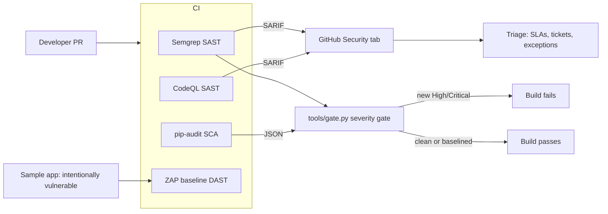

# appsec-pipeline-lab

A portfolio project demonstrating a working application security
pipeline: an intentionally vulnerable Flask application, scanned in CI
by Semgrep, CodeQL, pip-audit, and OWASP ZAP, with a severity gate that
fails the build on new High and Critical findings, plus the triage and
program documentation a real AppSec function runs on.

This is lab code written to show how I design and operate AppSec
controls end to end. The sample application is a training target and is
not production software; the pipeline, gate, and docs are the real
deliverables. Not affiliated with any employer.

## Architecture



## Quickstart

Requires Python 3.10 or newer. ZAP locally additionally requires
Docker; in CI it runs via `zaproxy/action-baseline`.

```bash
# 1. Install the local tooling (or use Docker fallbacks in the scripts)
pip install semgrep pip-audit pytest
pip install -r app/requirements.txt   # the vulnerable app's own deps

# 2. Run each stage locally -- same stages as CI
./scripts/run_sast.sh    # Semgrep  -> results/semgrep.sarif
./scripts/run_sca.sh     # pip-audit -> results/pip-audit.json
./scripts/run_dast.sh    # ZAP baseline via Docker -> results/zap-report.html

# 3. Apply the gating policy to the results
python tools/gate.py --sarif results/semgrep.sarif \
                     --pip-audit results/pip-audit.json \
                     --threshold high
# On this repo the gate FAILS: the sample app's findings are real.
# That is the demonstration working as intended.

# 4. Run the policy unit tests
python -m pytest tests/ -q
```

## What each control demonstrates

| Pipeline element | Where | AppSec JD requirement it evidences |
|---|---|---|
| Semgrep SAST with custom rulesets (python, secrets, OWASP Top Ten) | `.github/workflows/appsec.yml`, `scripts/run_sast.sh` | SAST program operation, rule selection and tuning |
| CodeQL security-extended queries | workflow `sast-codeql` job | Deep dataflow SAST, GitHub Advanced Security |
| SARIF upload to the GitHub Security tab | Semgrep + CodeQL jobs | Centralized findings management, one triage surface |
| pip-audit SCA + Dependabot + dependency-review-action | `sca` job, `.github/dependabot.yml` | Software composition analysis, dependency risk, PR-time supply-chain gating |
| OWASP ZAP baseline DAST with a committed rules file | `dast` job, `.zap/rules.tsv` | DAST operation, threshold tuning (FAIL/WARN/IGNORE) |
| Severity gate failing the build on new High/Critical | `tools/gate.py`, `gate` job | CI/CD security gating, policy as code, fail-closed design |
| Baseline and exception process | `policy/baseline.json`, `docs/false-positive-suppression.md` | Risk acceptance with owners, tickets, and expiry -- not silent ignores |
| Triage SLAs and finding lifecycle | `docs/triage-and-slas.md` | Vulnerability management program operation |
| Program design at org scale | `docs/program-design.md` | Program thinking: rollout, developer experience, metrics |
| Findings report from real local runs | `docs/sample-findings.md` | Evidence over assertion: what actually ran, what it found |

## The sample application

`app/app.py` is a small Flask app with six deliberate, commented
vulnerabilities: SQL injection, reflected XSS, a hardcoded secret,
MD5 password hashing, `pickle.loads` on request data, and Flask debug
mode. Its `app/requirements.txt` pins several dependency versions with
known CVEs so the SCA stage has real advisories to report. Each issue
is catalogued with its fix in `docs/sample-findings.md`.

## Docs

- `docs/sample-findings.md`: the honest findings report -- which
  scanners actually ran, their versions, and what they found.
- `docs/triage-and-slas.md`: severity mapping, remediation SLAs, the
  gating policy, and the finding lifecycle.
- `docs/false-positive-suppression.md`: how findings are legitimately
  suppressed (fix first, then config, then time-boxed baseline
  exceptions) and what a good record looks like.
- `docs/program-design.md`: how this one-repo pipeline scales into an
  organization-wide AppSec program.

## Honest limitations

- The sample app is a training target. Its vulnerabilities are textbook
  cases chosen for scanner visibility, not a model of a real codebase's
  defect distribution.
- ZAP here is an unauthenticated *baseline* scan: it checks headers,
  passive rules, and simple reflection. It is not an authenticated or
  full active scan, and the docs say so rather than dressing it up.
- Local scan coverage depends on what could be installed in the
  environment; `docs/sample-findings.md` records exactly what ran and
  what did not, and why.
- The gate is a policy demonstration: thresholds and the baseline model
  are production-shaped, but a real deployment tunes them per
  organization risk appetite.

## License

MIT. See `LICENSE`.
